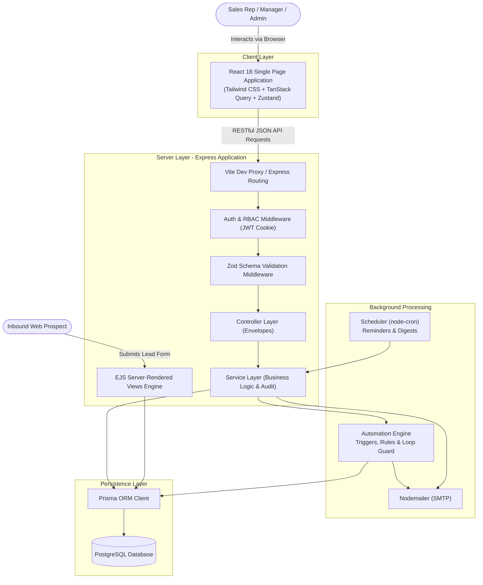
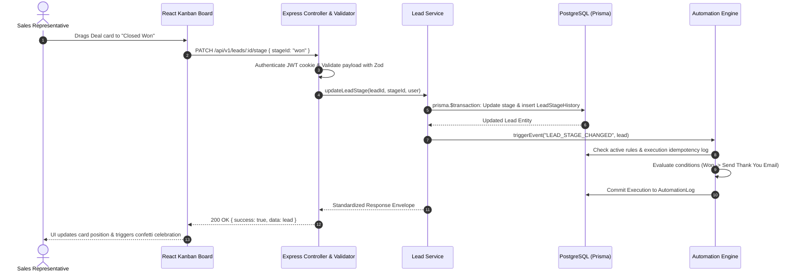

# SmartConnect CRM

[](LICENSE)
[](results/test-results.md)
[](https://nodejs.org/)
[](https://www.postgresql.org/)

**SmartConnect CRM** is a full-stack, enterprise-grade relationship management and sales automation platform engineered for modern go-to-market teams. Fast-growing companies often struggle with fragmented customer data scattered across disparate spreadsheets, lost inbound leads from lack of immediate ownership, missed follow-ups due to disorganized rep calendars, and zero real-time visibility into the revenue pipeline. SmartConnect CRM addresses these operational bottlenecks by unifying contacts, companies, multi-stage Kanban deal pipelines, automated email communications, intelligent background task reminders, and executive analytics into a cohesive, high-performance web system.

---

## 1. Project Objectives

- **Centralize Customer Intelligence**: Provide a single 360-degree source of truth for accounts, key decision-makers, communication histories, and internal collaborative notes.
- **Accelerate Deal Velocity**: Implement an interactive, drag-and-drop Kanban pipeline with stage histories, win probabilities, conversion workflows, and deal-loss attribution.
- **Eliminate Dropped Follow-ups**: Automate task scheduling and overdue alerts via recurring background cron jobs, in-app notifications, and scheduled morning digest briefings.
- **Scale Team Productivity**: Deliver an event-driven automation engine (trigger-condition-action), templated email dispatch with merge variables, and role-based data scoping for sales representatives, managers, and administrators.
- **Empower Sales Leadership**: Surface real-time revenue analytics, win/loss conversion rates, rep activity metrics, and filtered CSV export capabilities.

---

## 2. Features Matrix

### Implemented Features
- [x] **Authentication & Role-Based Access Control (RBAC)**: Secure cookie-based JWT sessions, password hashing with bcrypt, initial setup wizard, password reset tokens, and three distinct permission tiers (`ADMIN`, `MANAGER`, `REP`) with row-level ownership scoping.
- [x] **Executive Dashboard & Real-Time Analytics**: Metric KPI summary cards (Pipeline Value, Deals Won, Active Leads, Overdue Tasks), interactive Recharts (pipeline distribution, monthly revenue velocity, lead source breakdowns), and a team leaderboard.
- [x] **Customer 360 & Directory Management**: Multi-tab directory for Contacts and Companies, tag filtering, full text search, domain-based company association, CSV import wizard with column mapping, and a unified 360 customer timeline.
- [x] **Visual Kanban Sales Pipeline**: Drag-and-drop deal progression (`@dnd-kit`), custom pipeline stages, win-rate probability calculations, stage change history, closed-won celebratory confetti, and closed-lost reason logging.
- [x] **Follow-Up Task Management**: Interactive task table and FullCalendar grid view (Month/Week/Day), custom priority badges, snooze presets (1 hour, tomorrow, next week), task reassignment, and recurring task auto-generation.
- [x] **Unified Activity Stream**: Chronological audit trail logging calls, meetings, notes, and emails with timestamps, author tags, and entity associations.
- [x] **Templated Email Dispatch & Compliance**: In-app email composer with template variables (`{{firstName}}`, `{{companyName}}`, `{{ownerName}}`), Nodemailer SMTP transport, user-level rate limiting (50/hr), and contact unsubscribe link generation with `/unsubscribe/:token` opt-out compliance.
- [x] **Event-Driven Automation Engine**: Configurable trigger-condition-action workflow rules (`LEAD_CREATED`, `LEAD_STAGE_CHANGED`, `LEAD_STALE_IN_STAGE`, `FOLLOWUP_OVERDUE`, `CONTACT_CREATED`), round-robin rep assignment, safety limits (100 runs/hr), re-entry loop guards, and complete execution audit logging.
- [x] **Background Cron Scheduler (`node-cron`)**: Automated 5-minute follow-up reminders, automatic un-snoozing, and an 08:00 AM daily morning sales briefing email.
- [x] **Public Lead Capture & Server-Rendered EJS Views**: Public lead capture form (`/capture/:key`), honeypot spam protection, CSRF mitigation, responsive branded email layouts, and print-optimized customer profiles.
- [x] **Theme System**: High-contrast, theme-tokenized Light Mode and Dark Mode toggle with persistent state.

### Not Implemented / Future Scope
- [ ] **Two-Way Inbound Email Sync**: Real-time IMAP/POP3 or Microsoft Graph/Gmail webhook inbox listening for incoming customer replies (currently outbound-only).
- [ ] **Real-Time WebSockets**: Live multi-user collaboration and instant toast synchronization (currently powered by TanStack Query polling intervals).
- [ ] **Multi-Tenant Workspace Partitioning**: Schema-level organization partitioning for multi-company SaaS hosting (currently structured as a single-workspace deployment).
- [ ] **Bulk Marketing Campaigns**: Mass broadcast email campaigns with click heatmaps and unsubscribe list batching (currently restricted to individual and automated transactional emails).
- [ ] **Multi-Currency Pipeline**: Automatic currency conversion and multi-currency exchange rates (currently defaults to USD).

---

## 3. Technology Stack

| Technology | Role / Layer | Primary Architectural Justification |
| :--- | :--- | :--- |
| **React 18** | Frontend Framework | Declarative component model and concurrent rendering for smooth UI transitions. |
| **Vite** | Frontend Tooling | Lightning-fast Hot Module Replacement (HMR) and optimized ES module production builds. |
| **Tailwind CSS & Radix UI** | Styling & UI Primitives | Accessible, unstyled UI primitives styled with custom utility tokens supporting instant light/dark theming. |
| **TanStack Query (v5)** | State & Data Fetching | Declarative server-state caching, automatic background refetching, and query invalidation. |
| **Zustand** | Client State Store | Minimalist client store for authentication session state, sidebar toggle, and modal controls. |
| **Node.js & Express** | Backend Application Server | High-throughput asynchronous event loop with robust middleware composition and routing. |
| **PostgreSQL** | Relational Database | ACID-compliant relational data integrity, foreign keys, and performant indexed queries. |
| **Prisma ORM** | Object-Relational Mapper | Type-safe schema migrations, intuitive relation traversal, and transaction management. |
| **EJS (Embedded JS)** | Template Engine | Server-side rendering for public lead capture forms, email layouts, and print reports. |
| **Zod** | Validation Library | Strict runtime schema parsing and sanitization for request payloads, parameters, and environment configs. |
| **JWT (HTTP-only Cookies)**| Session Management | Stateless, tamper-proof user authentication protected against Cross-Site Scripting (XSS). |
| **node-cron** | Task Scheduler | Robust in-process background scheduling for recurring digests, task reminders, and automations. |
| **Nodemailer** | Mail Delivery Engine | Flexible SMTP transport supporting transactional notifications and rich HTML email templates. |

---

## 4. System Architecture & Data Flow

### Architecture Overview


### Data Flow Sequence (Example: Lead Stage Update)


---

## 5. Folder Structure

```text
smartconnect/
├── client/                     # Frontend Application (React 18 + Vite)
│   ├── public/                 # Static web assets & favicons
│   ├── src/
│   │   ├── api/                # Axios API client & request wrappers
│   │   ├── components/         # Reusable UI component library (Radix primitives)
│   │   │   ├── common/         # ErrorBoundary, KeyboardShortcuts, Modals
│   │   │   ├── email/          # EmailComposerModal
│   │   │   ├── followups/      # Task modals, snooze & reassignment dialogs
│   │   │   ├── layout/         # TopBar, Sidebar, CommandPalette, Notifications
│   │   │   └── ui/             # Standardized atomic design system primitives
│   │   ├── context/            # ThemeContext (Light/Dark mode)
│   │   ├── hooks/              # Custom React hooks (debounce, global shortcuts)
│   │   ├── layouts/            # AppLayout (protected shell), AuthLayout
│   │   ├── lib/                # TanStack queryClient, utility functions, tokens
│   │   ├── pages/              # Routed view pages
│   │   │   ├── activities/     # Unified audit stream
│   │   │   ├── auth/           # Login, Setup, ForgotPassword, AcceptInvite
│   │   │   ├── customers/      # Contact & Company directories, Customer 360
│   │   │   ├── dashboard/      # Executive KPIs & performance charts
│   │   │   ├── followups/      # List & FullCalendar task interfaces
│   │   │   ├── leads/          # Kanban board, lead drawers, conversion
│   │   │   ├── reports/        # Analytics, funnel velocity, CSV streaming
│   │   │   └── settings/       # Team, Pipeline, Automations, Templates, Tags
│   │   ├── stores/             # Zustand stores (authStore, uiStore, dialogStore)
│   │   └── styles/             # Tailwind tokens and globals.css
│   └── vite.config.js          # Vite build config & proxy definitions
│
├── server/                     # Backend Application (Node.js + Express)
│   ├── prisma/
│   │   ├── schema.prisma       # 20 Relational data models & enums
│   │   ├── seed.js             # Realistic Faker-based demo data generator
│   │   └── migrations/         # SQL migration history
│   ├── src/
│   │   ├── config/             # Environment, Prisma client, Nodemailer config
│   │   ├── constants/          # Application-wide enum values & roles
│   │   ├── controllers/        # Request validation & API envelope handlers
│   │   ├── jobs/               # Background cron schedulers (node-cron)
│   │   ├── middleware/         # Auth JWT, RBAC guards, rate-limiting, error handler
│   │   ├── routes/             # Express API routing endpoints
│   │   ├── services/           # Domain logic, automation engine, email delivery
│   │   ├── utils/              # Query helpers, CSV streaming, template renderer
│   │   ├── validators/         # Zod request validation schemas
│   │   ├── views/              # Server-rendered EJS templates (forms, print, emails)
│   │   └── app.js              # Express app setup and middleware pipeline
│   ├── tests/                  # 12 Integration test suites (node:test + supertest)
│   ├── index.js                # Server entrypoint & graceful shutdown
│   └── package.json            # Server dependencies & scripts
│
├── docs/                       # Technical & Architectural Documentation
│   ├── ARCHITECTURE.md         # Detailed technical design & lifecycle traces
│   ├── CHALLENGES.md           # Engineering challenges, causes, and resolutions
│   ├── LIMITATIONS.md          # Architectural limitations and future roadmap
│   ├── PRESENTATION.md         # Marp slide deck & viva defense transcript
│   ├── presentation.html       # Self-contained interactive HTML slide deck
│   └── SmartConnect_CRM_Presentation.pptx # 16:9 PowerPoint slide presentation
│
├── results/                    # Verification Deliverables & Academic Proof
│   ├── screenshots/            # 14 High-resolution application screenshots
│   ├── test-results.md         # Official 90/90 integration test execution log
│   └── manual-test-checklist.md# Manual test execution matrix
│
├── package.json                # NPM workspaces configuration
├── .gitignore                  # Git exclusions (node_modules, .env, dist, logs)
└── LICENSE                     # MIT Open Source License
```

---

## 6. Setup Guide in 5 Steps

### Prerequisites
- **Node.js**: v20.x or higher (`node -v`)
- **NPM**: v10.x or higher (`npm -v`)
- **PostgreSQL**: v15 or higher running locally or via Docker

### Step 1: Clone the Repository
```bash
git clone <repository-url>
cd smartconnect
```

### Step 2: Configure Environment Variables
Copy the example environment files for both backend and frontend:
```bash
cp server/.env.example server/.env
cp client/.env.example client/.env
```
*(Update `server/.env` with your local PostgreSQL credentials and optional SMTP settings).*

### Step 3: Install Dependencies
Install all workspace dependencies from the project root:
```bash
npm install
```

### Step 4: Run Migrations & Seed Sample Data
Initialize the database tables and populate realistic enterprise demo data:
```bash
npm run db:migrate
npm run db:seed
```

### Step 5: Start the Development Application
Launch both backend (`http://localhost:5001`) and frontend (`http://localhost:5173`) concurrently:
```bash
npm run dev
```
Open **`http://localhost:5173`** in your browser to begin exploring the application.

---

## 7. Environment Variables Reference

### Backend Configuration (`server/.env`)
| Variable | Required | Default Value | Description |
| :--- | :---: | :--- | :--- |
| `PORT` | No | `5001` | HTTP port the Express backend listens on. |
| `NODE_ENV` | No | `development` | Runtime environment (`development`, `production`, `test`). |
| `DATABASE_URL` | **Yes** | `postgresql://...` | PostgreSQL connection string with credentials. |
| `JWT_SECRET` | **Yes** | — | Cryptographic secret key for signing session tokens (min 16 chars). |
| `JWT_EXPIRES_IN` | No | `7d` | Token validity duration before re-authentication is required. |
| `CLIENT_URL` | No | `http://localhost:5173` | Allowed origin for CORS and email redirect links. |
| `APP_URL` | No | `http://localhost:5001` | Public host URL for webhook and public form links. |
| `SMTP_HOST` | No | `smtp.mailtrap.io` | SMTP mail server hostname. |
| `SMTP_PORT` | No | `2525` | SMTP server port (e.g. 587 for TLS, 465 for SSL). |
| `SMTP_USER` | No | — | SMTP username / credential. |
| `SMTP_PASS` | No | — | SMTP password / App Password. |
| `MAIL_FROM` | No | `SmartConnect CRM <...>` | Default outgoing sender header for emails. |

### Frontend Configuration (`client/.env`)
| Variable | Required | Default Value | Description |
| :--- | :---: | :--- | :--- |
| `VITE_API_URL` | No | `/api/v1` | Base API URL prefix proxied by Vite dev server. |

---

## 8. Seeded Demo Accounts (Development Only)

All seeded test accounts share the common password: **`Admin@123`**

| Email Address | Role | Name | Permissions & Scope |
| :--- | :---: | :--- | :--- |
| `admin@smartconnect.com` | **ADMIN** | Admin User | Global access; user & role management; pipeline configuration; all automations; system audits. |
| `sarah.manager@smartconnect.com` | **MANAGER** | Sarah Connor | Access to all leads, contacts, and reports across all sales reps; template management. |
| `alex.rep@smartconnect.com` | **REP** | Alex Rivera | Scoped access; views and edits only owned leads, assigned follow-ups, and personal contacts. |
| `jordan.rep@smartconnect.com` | **REP** | Jordan Lee | Scoped sales representative account for pipeline collaboration. |
| `morgan.rep@smartconnect.com` | **REP** | Morgan Smith | Scoped sales representative account for pipeline collaboration. |

---

## 9. Available NPM Scripts & Testing Instructions

| Script Command | Scope | Description |
| :--- | :---: | :--- |
| `npm run dev` | Root | Starts both backend and frontend concurrently in development mode. |
| `npm run dev:server` | Backend | Starts Express server with `nodemon` live-reload. |
| `npm run dev:client` | Frontend | Starts Vite client dev server at `http://localhost:5173`. |
| `npm run test --workspace=server` | Backend | Runs all 90 integration test suites via Node native test runner. |
| `npm run lint` | All | Executes ESLint across both `client` and `server` workspaces. |
| `npm run build` | Frontend | Builds the production Vite frontend bundle into `client/dist`. |
| `npm run db:migrate` | Backend | Applies Prisma database migrations. |
| `npm run db:seed` | Backend | Seeds database with reproducible Faker demo accounts and entities. |
| `npm run db:studio` | Backend | Launches interactive browser GUI for the PostgreSQL database. |

### Running the Test Suite
Execute the automated test suite directly:
```bash
npm run test --workspace=server
```
All 90 integration tests across 12 test suites will run against your database connection in an isolated test context. For detailed test logs, see [results/test-results.md](results/test-results.md).

---

## 10. Application Screenshots

High-resolution visual evidence of each core view is preserved in [results/screenshots/](results/screenshots/):

| View / Feature | Preview File Link | Description |
| :--- | :--- | :--- |
| **Login Screen** | [01-login.png](results/screenshots/01-login.png) | Responsive split-screen branded authentication interface. |
| **Executive Dashboard (Light)** | [02-dashboard-light.png](results/screenshots/02-dashboard-light.png) | Summary KPI metric cards, Recharts velocity series, and leaderboard in light mode. |
| **Executive Dashboard (Dark)** | [03-dashboard-dark.png](results/screenshots/03-dashboard-dark.png) | High-contrast dark theme rendering of dashboard analytics. |
| **Customer Directory** | [04-customers-list.png](results/screenshots/04-customers-list.png) | Contact and Company tabs with search filters and tag badges. |
| **Customer 360 View** | [05-customer-360.png](results/screenshots/05-customer-360.png) | Unified 360-degree customer profile with activity audit timeline and open deals. |
| **Leads Kanban Board (Light)** | [06-leads-kanban-light.png](results/screenshots/06-leads-kanban-light.png) | Multi-column drag-and-drop sales pipeline with deal valuations. |
| **Leads Kanban Board (Dark)** | [07-leads-kanban-dark.png](results/screenshots/07-leads-kanban-dark.png) | Dark theme representation of the interactive sales pipeline board. |
| **Lead Detail Drawer** | [08-lead-drawer.png](results/screenshots/08-lead-drawer.png) | Slide-out right sheet displaying stage progression, contacts, and quick actions. |
| **Follow-Ups List View** | [09-followups-list.png](results/screenshots/09-followups-list.png) | Task management interface with status filters, priority indicators, and snooze actions. |
| **Follow-Ups Calendar** | [10-followups-calendar.png](results/screenshots/10-followups-calendar.png) | FullCalendar monthly and weekly schedule grid of scheduled touchpoints. |
| **Activities Audit Stream** | [11-activities.png](results/screenshots/11-activities.png) | Chronological unified stream of calls, meetings, notes, and emails. |
| **Analytics & Reports** | [12-reports.png](results/screenshots/12-reports.png) | Sales velocity charts, lead source conversion breakdowns, and CSV export. |
| **Admin Settings & Automations** | [13-settings.png](results/screenshots/13-settings.png) | Full administrative panel showing Team, Pipeline, Automations, and Template builders. |
| **Rep Restricted RBAC View** | [14-rep-restricted-access.png](results/screenshots/14-rep-restricted-access.png) | Representative account proving role boundary enforcement (admin tabs stripped). |


